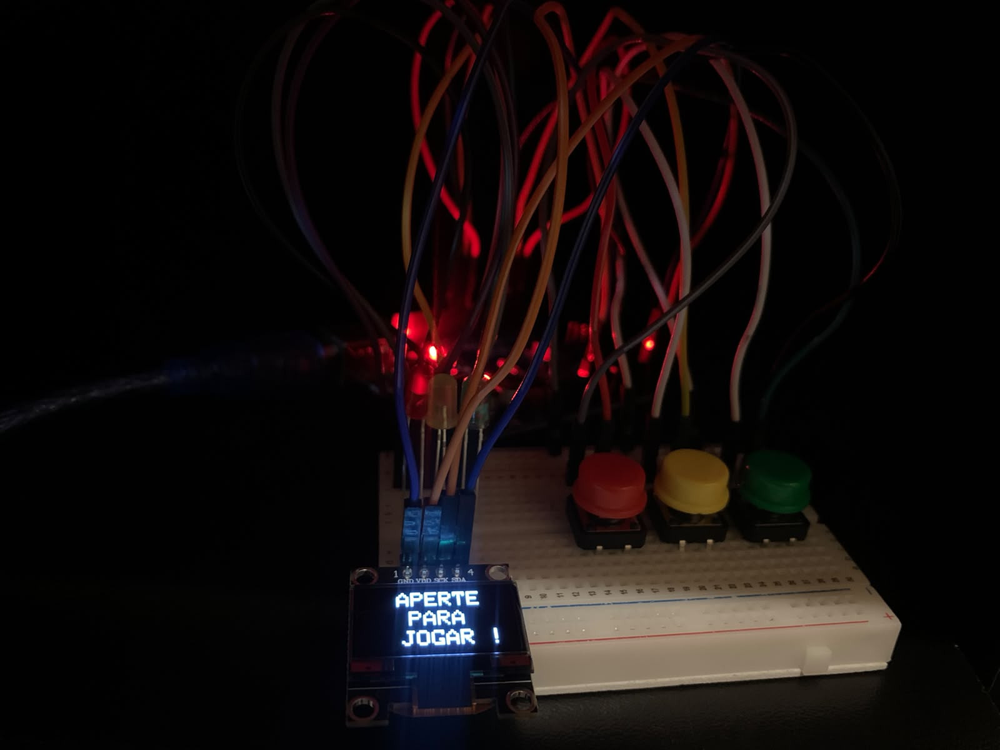

# Jogo da Memória com Arduino

Jogo da memória desenvolvido com **Arduino**, utilizando LEDs, botões físicos e um display OLED para apresentar as instruções e o progresso do jogo.

O objetivo é memorizar a sequência de luzes exibida pelos LEDs e reproduzi-la utilizando os botões correspondentes.

## Demonstração do projeto

##  Funcionamento

- 🔴 **Botão vermelho:** inicia o jogo e representa o LED vermelho.
- 🟡 **Botão amarelo:** representa o LED amarelo.
- 🟢 **Botão verde:** representa o LED verde.
- 📺 **Display OLED:** exibe as instruções, as rodadas e as mensagens de vitória ou derrota.

O jogo possui três rodadas, com sequências de dificuldade crescente:

- **Rodada 1:** sequência de 4 luzes.
- **Rodada 2:** sequência de 6 luzes.
- **Rodada 3:** sequência de 8 luzes.

O jogador precisa pressionar os botões na mesma ordem em que os LEDs acenderam. Se errar, o jogo termina. Ao completar as três rodadas, vence a partida!

##  Tecnologias e componentes

### Software
- C++
- Arduino IDE / VS Code
- Biblioteca Adafruit SSD1306
- Biblioteca Adafruit GFX
- Biblioteca Wire

### Hardware
- Arduino
- Display OLED 128x64
- 3 LEDs: vermelho, amarelo e verde
- 3 botões
- Protoboard
- Jumpers
