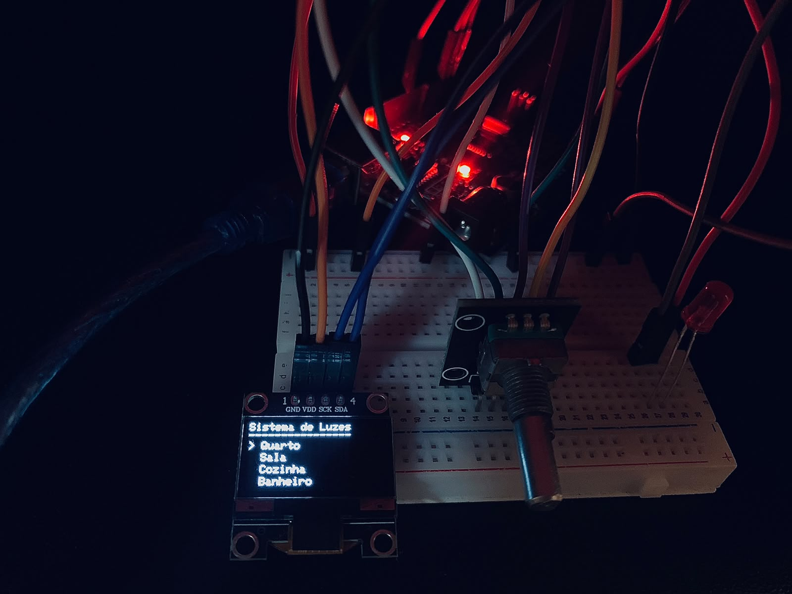

# Sistema de Controle de Luzes 

Projeto desenvolvido com Arduino para simular um sistema de controle de iluminação por ambientes, utilizando um encoder rotativo e um display OLED para navegar pelo menu e controlar as opções de iluminação.

O sistema permite selecionar um ambiente, acessar as opções de controle e visualizar o estado da iluminação diretamente no display.

##  Demonstração do projeto

## Funcionamento

O sistema possui um menu interativo com quatro ambientes:

-  **Quarto**
-  **Sala**
-  **Cozinha**
-  **Banheiro**

O encoder rotativo permite navegar pelas opções do menu, enquanto o botão integrado confirma a seleção.

Ao selecionar um ambiente, o usuário pode escolher entre três opções:

- **Ligar:** ativa a iluminação.
- **Desligar:** desativa a iluminação.
- **Voltar:** retorna ao menu de ambientes.

O display OLED apresenta as opções disponíveis e informa se a iluminação do ambiente selecionado está ligada ou desligada.

